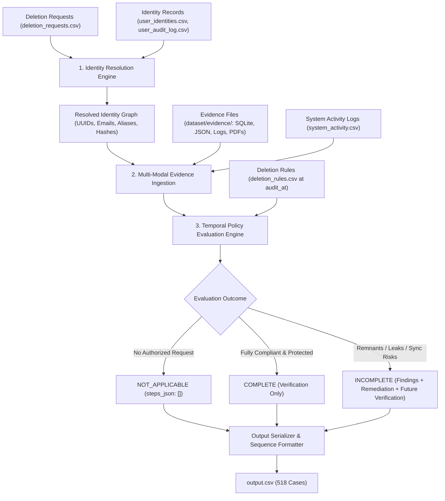

# GhostData: AI-Powered Deletion-Audit Agent
**Team Madira** | Automated Data Deletion & Privacy Verification System

---

## 1. Executive Summary & Objective

In modern distributed microservice architectures, executing a user data deletion request ("Right to be Forgotten" under GDPR/CCPA) is notoriously prone to silent failures. As demonstrated by Northstar Shop's \$2.4M incident, primary account deletions often fail because:
1. Replicas, secondary reporting stores, search caches, and attachments quietly retain unredacted PII.
2. Automated synchronization, ETL pipelines, and recurring import jobs actively resurrect deleted records.
3. Unsanitized backup and restore paths present continuous re-exposure risks.

The **GhostData Deletion-Audit Agent** is an autonomous, evidence-driven auditing engine. It treats reported workflow status claims (`reported_status == "Complete"`) purely as unverified assertions. The agent inspects concrete system evidence across distributed stores at a specific timestamp (`audit_at`), resolves complete historical user identity graphs, enforces strict policy rules, identifies data leaks or active recreation vectors, and generates a fully compliant, strictly sorted audit report (`output.csv`).

---

## 2. System Architecture

The agent operates across five sequential stages:



### Core Architecture Components

1. **Identity Resolution Engine (`src/identity_resolver.py`):**
   * Correlates primary user IDs, historical emails, secondary phone numbers, device tokens, and hashed identifiers across `user_identities.csv` and historical mutation logs in `user_audit_log.csv`.
   * Builds an immutable `IdentityGraph` per case, ensuring that legacy aliases or past emails are tracked across secondary databases and backups.

2. **Multi-Modal Evidence Parser (`src/evidence_parser.py`):**
   * Reads the manifest (`evidence_files.csv`) and extracts text, structured rows, and metadata from:
     * **Relational / SQLite Snapshots:** Primary, regional, reporting, and failover replicas.
     * **NoSQL / JSON Data Dumps:** Document stores, search index caches, and analytics exports.
     * **Server & Access Logs:** Chronological event traces and webhook payloads.
     * **Unstructured Attachments & Documents:** Customer support tickets and PDFs.
   * Cross-references ongoing data movement and scheduled batch operations via `system_activity.csv`.

3. **Temporal Policy Engine (`src/policy_engine.py`):**
   * Evaluates records strictly at the temporal boundary: `timestamp <= audit_at`.
   * Enforces rules from `deletion_rules.csv` determining mandatory treatment: **DELETE**, **REDACT**, **ANONYMIZE**, or **RETAIN**.
   * **Account Tombstone Rule:** Validates that while a stable `user_id` may remain to maintain foreign-key integrity for legally retained records (e.g., invoices/tax), all direct personal identifiers (**name, email, phone, and email_hash**) are strictly absent or redacted.

4. **Risk & Vector Discovery:**
   * Detects **Active Data Flows:** Ongoing sync/import jobs in `system_activity.csv` that touch user-associated entities post-deletion.
   * Detects **Restore Risks:** Unrestricted backups capable of restoring purged data into active production stores.

5. **Compliant Step Generator & Serializer (`src/plan_generator.py`):**
   * Constructs standardized JSON steps strictly partitioned by phase:
     $$\text{FINDING} \longrightarrow \text{REMEDIATION} \longrightarrow \text{VERIFICATION}$$
   * Enforces mandatory operation sequence and deterministic tie-breaking (sorted by `system_id` ascending, then `resource_id` ascending).
   * Validates evidence references: existing findings and current verifications cite valid IDs; proposed remediation and future verifications use `""`.


---

## 4. Setup & Installation

### Prerequisites
* **Python:** Version 3.10, 3.11, or 3.12
* **Git:** Configured repository access
* **OS:** Windows, macOS, or Linux

### 1. Clone & Set Up Virtual Environment

```bash
# Clone the repository
git clone https://github.com/GhostData-Team-Madira-/GhostData-Team-Madira-.git
cd GhostData-Team-Madira-

# Create a virtual environment
python -m venv .venv

# Activate the virtual environment
# Windows (PowerShell):
.venv\Scripts\Activate.ps1
# Linux/macOS:
source .venv/bin/activate

# Upgrade pip and install dependencies
pip install --upgrade pip
pip install -r requirements.txt
```

### 2. Environment Configuration

Copy the example environment configuration:

```bash
cp .env.example .env
```

Edit `.env` with your appropriate configuration values:

```ini
LLM_PROVIDER=gemini
LLM_API_KEY=your_actual_api_key_here
LLM_MODEL_NAME=gemini-2.5-pro
DATASET_DIR=./dataset
OUTPUT_FILE=./output.csv
```

> **Security Warning:** Never commit `.env` or any file containing API keys or private credentials to git.

---

## 5. Execution Instructions

### Run the Full Audit Pipeline (All 518 Cases)

To execute the complete audit analysis and generate `output.csv`:

```bash
python run_audit.py --requests dataset/deletion_requests.csv --evidence dataset/evidence_files.csv --output output.csv
```

#### CLI Options
* `--requests <path>`: Path to `deletion_requests.csv` (default: `dataset/deletion_requests.csv`).
* `--rules <path>`: Path to `deletion_rules.csv` (default: `dataset/deletion_rules.csv`).
* `--evidence <path>`: Path to `evidence_files.csv` (default: `dataset/evidence_files.csv`).
* `--identities <path>`: Path to `user_identities.csv` (default: `dataset/user_identities.csv`).
* `--audit-log <path>`: Path to `user_audit_log.csv` (default: `dataset/user_audit_log.csv`).
* `--system-activity <path>`: Path to `system_activity.csv` (default: `dataset/system_activity.csv`).
* `--output <path>`: Path to output CSV file (default: `output.csv`).
* `--limit <n>`: Optional flag to process only the first $N$ cases (useful for dry runs and debugging).

---

## 6. Verification & Quality Assurance

Before packaging deliverables, validate the generated `output.csv` against all contest specifications using our validator script:

```bash
python validate_submission.py --file output.csv
```

The validation suite verifies:
1. **Header & Structure:** Exact column header `case_id,deletion_status,steps_json`.
2. **Row Count:** Exactly 518 data rows, strictly ordered by `case_id` ascending.
3. **Status Integrity:** Only valid statuses (`COMPLETE`, `INCOMPLETE`, `NOT_APPLICABLE`).
4. **`NOT_APPLICABLE` Handling:** Strict verification that `steps_json == "[]"`.
5. **Step Sequence & Numbering:** `step_no` is strictly 1-based and consecutively increasing without gaps.
6. **Phase & Operation Order:** Strict adherence to Phase order (`FINDING` $\rightarrow$ `REMEDIATION` $\rightarrow$ `VERIFICATION`) and intra-phase operation ordering.
7. **Tie-Breaking Determinism:** Verifies ascending sorting on `system_id` then `resource_id`.
8. **Evidence ID Integrity:** Ensures findings and verifications cite valid IDs, while proposed remediations/future verifications pass `""`.

---

## 7. Packaging & Submission

To build the final submission archive `code.zip`:

```bash
# Ensure evaluation reports are populated
# Package files excluding dataset, virtual environments, caches, and local secrets
zip -r code.zip src/ evaluation/ README.md run_audit.py validate_submission.py requirements.txt .env.example -x "*.pyc" -x "*__pycache__*" -x "*.venv*"
```

Verify that `code.zip` contains:
* Runnable source code (`src/`, `run_audit.py`, `validate_submission.py`)
* Comprehensive `README.md` and `.env.example`
* Complete `evaluation/evaluation_report.md` (with metrics and 3 custom test cases)
* Complete `evaluation/usage_report.md` (with token usage and cost analysis)
* **Strictly excludes** `dataset/`, virtual environments, cache files, and API keys.
