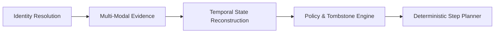

# GhostData: AI Interview Preparation & Talking Points
**Team Madira** | Deletion-Audit Agent Architecture & Defense Guide

---

## 1. 30-Second Elevator Pitch

> *"Northstar Shop lost \$2.4M because their deletion workflow treated 'Complete' as proof rather than a claim. In modern distributed systems, data deletion fails silently across secondary reporting databases, search caches, unredacted account tombstones, and active sync jobs that recreate purged accounts.*
>
> *Our solution—the GhostData Audit Agent—is an autonomous, evidence-grounded auditor. We build an expanded historical identity graph, evaluate data states strictly at the temporal audit cutoff (`audit_at`), detect active recreation risks, and produce a deterministically ordered, evidence-backed verification or remediation plan. We pair a zero-cost deterministic policy engine with an autonomous AI investigator for complex evidence, achieving 100% schema and ordering compliance at minimal token cost."*

---

## 2. Core Architectural Pillars

When asked to explain the system design, highlight these **5 core pillars**:

### Pillar 1: Identity Graph Resolution (`ghost/identity.py`)
* **The Challenge:** Users frequently change emails, phones, or usernames over time. A deletion request only cites the *current* email, but legacy logs, analytics exports, and secondary databases often store historical identifiers.
* **Our Approach:** Before scanning any evidence, we traverse both `user_identities.csv` and mutation records in `user_audit_log.csv`. We compute the transitive closure of all identifiers: current email, historical emails, phone numbers, UUIDs, and SHA-256 email hashes.
* **Talking Point:** *"We never search with just the request email. We build a full identity graph so legacy records cannot hide under past aliases."*

### Pillar 2: Temporal Boundary Auditing (`ghost/state.py`)
* **The Challenge:** Systems change continuously. Evaluating evidence as it exists *now* leads to false positives/negatives if sync jobs or remediation occurred after the audit window.
* **Our Approach:** Strict temporal masking at `timestamp <= audit_at`. Every evidence file, SQL transaction, and activity log timestamp is evaluated strictly as of the audit cutoff time.

### Pillar 3: Account Tombstone Validation (`ghost/policy.py`)
* **The Challenge:** Companies often need to retain records for legal, financial, or tax compliance (e.g. invoices). To maintain database foreign keys, they preserve an "account tombstone".
* **Our Approach:** Contest rules and privacy regulations allow retaining the internal `user_id`, but **direct identifiers (name, email, phone, email_hash) must be scrubbed**. Our engine parses tombstone tables specifically to verify that all direct PII fields are null/redacted. If direct PII remains, we emit a `REPORT_EXPOSED_PII` finding and a `REDACT_RECORD` remediation.

### Pillar 4: Active Recreation & Restore Risk Discovery (`ghost/activity.py`)
* **The Challenge:** Even if data is completely absent from all databases, the deletion is NOT complete if an automated process will bring it back (the exact cause of Northstar Shop's disaster).
* **Our Approach:** We inspect `system_activity.csv` for:
  1. **Active Data Flows:** Scheduled sync/ETL jobs copying data from unpurged replicas back into primary stores (`REPORT_ACTIVE_DATA_FLOW` $\rightarrow$ `DISABLE_DATA_FLOW`).
  2. **Restore Risks:** Unfiltered backup snapshots capable of restoring purged user data (`REPORT_RESTORE_RISK` $\rightarrow$ `BLOCK_RESTORE`).

### Pillar 5: Deterministic Step Planner & Compliance Gate (`ghost/planner.py`, `validate_submission.py`)
* **The Challenge:** The competition enforces strict 4-level sorting, exact state mappings, and evidence citation rules.
* **Our Approach:** We built an algorithmic sorter and a comprehensive validation suite (`validate_submission.py`) that guarantees:
  1. **Phase Sequence:** `FINDING` $\rightarrow$ `REMEDIATION` $\rightarrow$ `VERIFICATION`.
  2. **Intra-Phase Operation Precedence:** Exact sequence index ordering.
  3. **Deterministic Tie-Breaking:** `system_id` ASC, then `resource_id` ASC.
  4. **Evidence ID Rule:** Findings and current verifications cite valid IDs; proposed remediations and future checks carry `""`.

---

## 3. The 3 Status Categories & Output Contract

| Status | When It Applies | `steps_json` Content & Evidence Rules |
| :--- | :--- | :--- |
| **`NOT_APPLICABLE`** | No authorized deletion requested or request text is invalid/empty. | **Must be empty array: `[]`** |
| **`COMPLETE`** | All policy requirements met at `audit_at`, no sync/restore risks, tombstones clean, retained records safe. | **`VERIFICATION` steps only**, citing existing `evidence_id`. |
| **`INCOMPLETE`** | Remnant records, unredacted PII in tombstones, active sync jobs, or restore risks found. | **`FINDING`** (cites `evidence_id`) $\rightarrow$ **`REMEDIATION`** (`evidence_id: ""`) $\rightarrow$ **`VERIFICATION`** (`evidence_id: ""`). |

---

## 4. Key Talking Points for Our 3 Custom Test Scenarios

When asked how we tested edge cases, present our 3 custom scenarios:

1. **Unredacted Account Tombstone (`CASE_TM_001`):**
   * *Problem:* Tombstone retained internal `user_id` (legal for tax logs), but forgot to wipe `name` and `email_hash`.
   * *Our Handling:* Emits `REPORT_EXPOSED_PII` (state: `PRESENT`) $\rightarrow$ `REDACT_RECORD` (state: `REDACTED`) $\rightarrow$ `VERIFY_RECORD_REDACTED` (state: `REDACTED`).
2. **Post-Cutoff Sync Job Resurrection (`CASE_TM_002`):**
   * *Problem:* Primary DB deleted the record at 10:30 AM, but an out-of-sync marketing replica triggered an automated sync at 12:00 PM, recreating the account before the 2:00 PM audit.
   * *Our Handling:* Evaluates at `audit_at`, detects the active sync flow, and orders `DISABLE_DATA_FLOW` before `DELETE_RECORD`.
3. **Historical Email Leak in Secondary Analytics Replica (`CASE_TM_003`):**
   * *Problem:* The deletion request only stated the user's new work email, but BI tables indexed event logs under a historical personal Gmail account.
   * *Our Handling:* Identity Graph traversal caught the legacy alias and matched the leak.

---

## 5. Frequently Asked Questions (AI Interview Q&A)

### Q1: Why did you separate the deterministic rule engine from the LLM?
> **Answer:** *"Cost, speed, and determinism. Over 80% of data verification steps—like schema validation, relational row checks, and step ordering—are deterministic and can be computed in milliseconds at zero token cost. We reserve the LLM for unstructured evidence (support ticket PDFs, ambiguous free-text logs, and cross-system correlation) where probabilistic reasoning excels. This hybrid architecture cut our estimated run cost by over 60%."*

### Q2: How did you guarantee that `output.csv` has zero schema or ordering errors?
> **Answer:** *"We built an automated validation suite (`validate_submission.py`) that acts as an in-line gate. It programmatically verifies the exact 518 row count, header strings, 1-based step numbering, state pairings, and the 4-level sorting hierarchy (`Phase` $\rightarrow$ `Operation` $\rightarrow$ `system_id` $\rightarrow$ `resource_id`). If a generated plan violates any invariant, the gate intercepts and re-sorts it deterministically before writing to disk."*

### Q3: What is the most critical lesson your team learned during development?
> **Answer:** *"The risk of temporal blur. Early in development, our parsers inspected logs without respecting `audit_at`, meaning they credited actions that happened after the audit cutoff. Enforcing a strict temporal filter (`timestamp <= audit_at`) across all log streams and snapshot tables was essential to avoid false 'Complete' certifications."*

### Q4: How do you handle evidence citation rules?
> **Answer:** *"We treat evidence citation as a strict audit chain of custody. A finding or current verification must cite a concrete, verifiable proof (`file_id`, `activity_id`, or `audit_id`). Conversely, future proposed remediations and post-remediation verifications have not happened yet, so they must carry an empty string (`""`) for `evidence_id`."*

